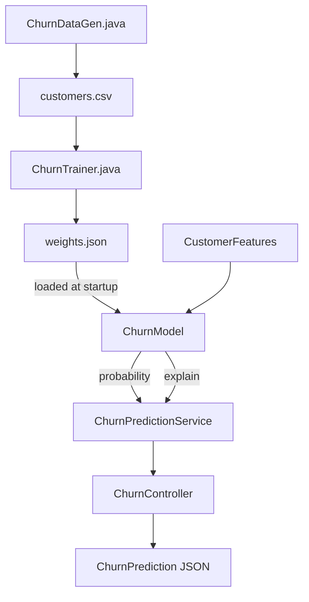

# Architecture

## Components

| Component                 | Responsibility                                                          |
|-----------------------------|-----------------------------------------------------------------------|
| `tools/ChurnDataGen.java`   | (Offline, one-off) generates the synthetic labeled dataset            |
| `tools/ChurnTrainer.java`   | (Offline, one-off) trains the model, evaluates it, writes weights.json|
| `ChurnModel`                 | Loads weights.json once at startup; predict + explain                |
| `ChurnPredictionService`     | Risk-tier classification on top of the raw probability                |
| `ChurnController`            | `/api/churn/predict`, `/api/churn/model-info`                        |

## Data Flow



### ASCII fallback

```
ChurnDataGen.java --> customers.csv --> ChurnTrainer.java --> weights.json
                                                                  |
                                                     (loaded once at startup)
                                                                  v
CustomerFeatures --> ChurnModel.predictProbability() + .explain() --> ChurnPredictionService
                                                                  |
                                                                  v
                                                       ChurnController --> JSON response
```

## Important Interfaces

- `ChurnModel` has no Spring dependency in its prediction math — `predictProbability`
  and `explain` are plain double-array arithmetic, independently verified
  against a standalone script before the tests were written (see
  docs/design-decisions.md). Only the constructor (loading `weights.json`
  from the classpath) touches Spring's `ClassPathResource`.
- `weights.json`'s shape (`featureNames`, `means`, `stds`, `weights`, `bias`,
  `trainingMeta`) is the entire contract between the offline trainer and the
  online service — retraining never requires a code change, only a new
  `weights.json`.

## External Dependencies

- Spring Web, Spring Validation (runtime)
- Spring Boot Test (JUnit 5, Mockito, AssertJ — test scope only)
- **No ML library.** `tools/ChurnTrainer.java` has zero dependencies beyond
  the JDK — see docs/design-decisions.md for why.

## Decision Points

- **Where standardization parameters live**: computed once from the
  training set inside `ChurnTrainer.java`, then shipped inside
  `weights.json` alongside the weights — so the serving code and the
  training code can never disagree about how a raw feature maps to its
  standardized value.
- **Why `/api/churn/model-info` reads training metadata straight from the
  artifact** rather than the README restating it by hand: it's the only way
  to guarantee the number a caller sees always matches the model actually
  loaded, even after a retrain.
